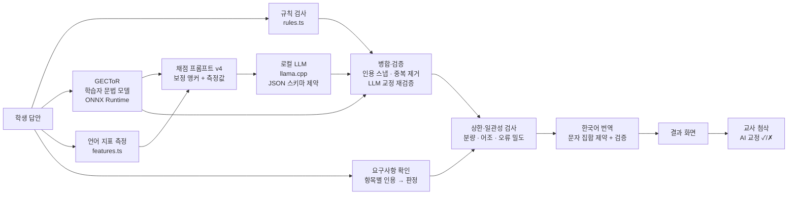
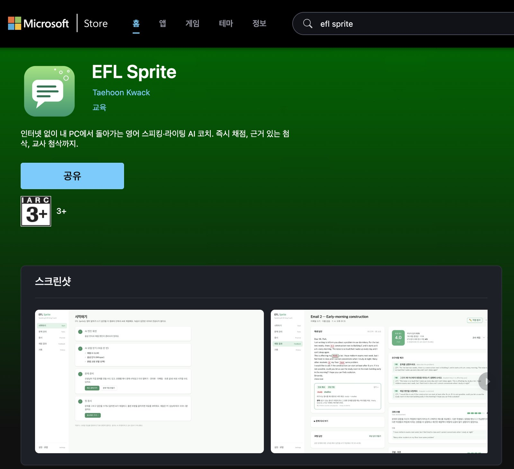

<p align="center">
  
</p>

<h1 align="center">EFL Sprite</h1>

<p align="center">
  <b>인터넷 없이, 내 PC 안에서 돌아가는 영어 스피킹·라이팅 AI 코치</b><br/>
  TOEFL iBT(2026) 스타일 연습 · 자동 채점 · 문법 첨삭 · 교사 첨삭
</p>

<p align="center">
  <a href="https://github.com/sonnykwack/efl-sprite/actions/workflows/build.yml"></a>
  
  
  <a href="https://apps.microsoft.com/detail/9MZT0SB40M2W"></a>
</p>

> **단국대학교 소프트웨어학과 졸업 프로젝트** · 곽태훈 (32210214) · 2026
>
> TOEFL-style practice app. ETS 및 TOEFL과 관련이 없으며, 앱의 점수는 AI 추정치로 공식 점수가 아닙니다.

## 📦 제출물
| 항목 | 위치 |
|---|---|
| 프로젝트 결과보고서 (PDF) | [`EFL-Sprite_결과보고서.pdf`](EFL-Sprite_결과보고서.pdf) (저장소 최상위) |
| 시연 영상 | 🎬 [YouTube — EFL Sprite 시연](https://youtu.be/Fr_a9Gi9KVw) |
| Microsoft Store | [EFL Sprite](https://apps.microsoft.com/detail/9MZT0SB40M2W) (2026-11-09 v0.1.0 게시, 11-12 v0.1.1 업데이트 게시) |
| 실행 파일 | [Releases](https://github.com/sonnykwack/efl-sprite/releases) — Windows 설치 파일 · macOS 앱 · 스토어 패키지(MSIX) |
| 소스 코드 | 이 저장소 (`src/` UI, `src-tauri/` Rust 백엔드) |
| 개발 문서 | [개발 가이드](docs/development.md) · [개발 과정 기록](docs/development-process.md) · [채점 실험 기록](docs/scoring-experiments.md) · [시연 대본](docs/demo-script.md) |

---

## 목차
1. [만든 이유](#1-만든-이유)
2. [개발 과정과 역할 분담](#2-개발-과정과-역할-분담)
3. [한눈에 보기](#3-한눈에-보기)
4. [주요 기능](#4-주요-기능)
5. [이 앱만의 특징](#5-이-앱만의-특징)
6. [기술적으로 공들인 부분](#6-기술적으로-공들인-부분)
7. [채점 품질 검증](#7-채점-품질-검증)
8. [Microsoft Store 배포](#8-microsoft-store-배포)
9. [설치와 실행 (개발자용)](#9-설치와-실행-개발자용)
10. [사용한 모델과 라이선스](#10-사용한-모델과-라이선스)
11. [한계와 향후 과제](#11-한계와-향후-과제)
12. [폴더 구조](#12-폴더-구조)

---

## 1. 만든 이유

영어 학원에서 TOEFL을 가르치면서 반복해서 부딪힌 문제가 있었습니다.

- **말하기·쓰기는 피드백이 병목입니다.** 읽기·듣기는 정답이 있어 학생이 혼자 연습할 수 있지만, 에세이 한 편과 녹음 하나를 첨삭하는 데는 강사의 시간이 들고, 학생은 피드백을 며칠씩 기다립니다. 연습량이 강사 시간에 묶여 버립니다.
- **2026년 TOEFL iBT 개편.** 2026년부터 시험 형식이 바뀌어 *Listen and Repeat, Take an Interview, Write an Email, Academic Discussion* 같은 새 유형이 생겼지만, 이 형식으로 연습하고 채점받을 도구는 아직 거의 없습니다.
- **기존 AI 첨삭 서비스의 한계.** 대부분 학생의 글과 목소리를 외부 서버로 보내야 하고, 구독료가 들며, 학원 컴퓨터실처럼 네트워크가 제한된 환경에서는 쓰기 어렵습니다. 무엇보다 *"왜 이 점수인지"*, *"왜 틀렸는지"*를 설명하지 못하는 경우가 많습니다.

그래서 목표를 이렇게 정했습니다.

> **학생은 언제든 혼자 연습하고 즉시 근거 있는 피드백을 받고, 강사는 AI가 놓친 부분만 바로잡는다.
> 그리고 이 모든 것이 학생의 PC 안에서만 일어난다.**

---

## 2. 개발 과정과 역할 분담

이 프로젝트는 AI 코딩 도구(Anthropic Claude Code)를 활용해 개발했습니다. 초기 버전은 AI 도구가 전체 코드를 작성했고, 이후 제가 **화면(프론트엔드) 코드를 참조 작성**했습니다. *참조 작성*이란 AI 도구가 만든 초기 버전을 참조해 구조와 동작을 이해한 뒤 직접 다시 작성한 것을 말합니다. 최종 코드 기준 역할 분담은 다음과 같습니다.

| 영역 | 담당 | 내용 |
|---|---|---|
| **화면 (프론트엔드)** | 저 (참조 작성) | 학생·교사가 쓰는 모든 화면(응시, 녹음, 채점 결과, 교사 첨삭, 문제 관리·공유, 기록, 설정, 문법 모델 실험). 채점 실험실(측정 도구)만 AI 작성본 유지 |
| **엔진·모델·채점 로직 (백엔드)** | AI 도구 | 추론 엔진 실행·관리, 문법 모델(GECToR) 포팅, 채점 파이프라인, 데이터베이스 |
| **백엔드 일부** | 저 (참조 작성) | 문제 파일·저장 경로·녹음 파일 처리(`taskfile.rs`, `paths.rs`, `audio.rs`), 따라 말하기 숫자 정규화, 문법 오류 분류 보정 |
| **기획·채점 기준·검증·배포** | 저 | 현장 문제 정의, 4개 유형 선정, 기준 답안 채점과 오류 지적, 블라인드 채점, 프롬프트 실험 방향 결정, 실기기 테스트, Microsoft Store 등록·심사 대응 |

**엔진·모델·채점 로직을 AI 도구로 작성한 이유**
1. **학부 과정에서 다루지 않은 기술** — whisper.cpp·llama.cpp를 외부 프로세스로 실행·관리하는 코드, 문법 교정 논문 모델(GECToR)의 ONNX Runtime 포팅은 학부 교과 범위를 넘어섭니다. 정확성과 안정성을 위해 AI 도구의 구현을 쓰고, 저는 동작 검증과 결과 판단에 집중했습니다.
2. **운영체제 호환성** — Windows(한글 사용자 폴더, 콘솔 창 숨김, 열린 파일 처리)와 macOS의 차이를 다루는 저수준 처리는 전문 지식이 필요합니다.
3. **측정 결과의 일관성** — 채점 일관성(SD)과 교사 일치도는 현재 채점 로직과 채점 실험실로 측정했습니다. 다시 작성하면 측정을 처음부터 반복해야 하므로 그대로 두었습니다.

참조 작성 이후 AI 도구로 수정한 부분은 두 커밋(교정 목록 배지 크기 조정, 녹음 화면 버그 3건)입니다.

### 제 판단이 설계를 바꾼 사례

AI 채점의 품질은 "무엇이 맞는 채점인가"를 아는 사람이 결과를 보고 고쳐 나가야 올라갑니다. 아래는 제가 결과를 보고 지적한 문제가 실제 설계 변경으로 이어진 사례입니다. 자세한 과정은 [`docs/development-process.md`](docs/development-process.md)에 정리했습니다.

| 내가 발견한 문제 | 바뀐 설계 | 결과 |
|---|---|---|
| "기준 답안에서 *Because*로 시작하는 조각문, 수일치, *so* 대신 *therefore*, 모호한 어휘…를 AI가 못 잡는다" | 결정적 규칙 검사 + 인용 스냅 도입 | 지적한 5개 항목 모두 검출 |
| "점수가 전반적으로 후하다. 55단어짜리 명령조 이메일이 4.0인 건 말이 안 된다" | 보정 앵커, 분량·어조·오류 밀도 상한, 밴드 환산표 재조정 | 같은 답안 4.0 → **2.5** |
| "밑줄에 마우스를 올려도 안 보이고, 왜 틀렸는지 설명이 없다" | 클릭형 교정 카드, 13개 오류 분류와 문법 원칙 | 교정마다 이유·원칙·예문 제공 |
| "전문 문법 모델이 있어야 한다" | 학습자 문법 교정 모델 GECToR 도입(Rust 포팅) | 의도적으로 넣은 오류 7/7 검출 |
| "피드백 한국어가 부자연스럽다 — *반응*, 한자 출력" | 문자 집합 제약 + 문장 단위 번역 + 검증 | 깨진 번역이 화면에 나오지 않음 |
| "맞는 문장에 엉뚱한 문법 교정이 붙는다" | 정확도 우선 구조: 문법은 문법 모델, LLM 교정은 재검증 | 맞는 글의 가짜 교정 제거 |
| "요구사항을 썼는데도 빠졌다고 한다" | 요구사항별 개별 판정(근거 인용 → 판정) | 질문형 문장도 정확히 인정 |
| "내 점수는 ETS 기준이 아니라 강사로서의 판단이다" | 검증 기준을 정직하게 재정의(ETS 기준표 채점, 2인 채점 계획) | 보고서의 주장 범위 명확화 |
| "학생이 문제를 일일이 입력하긴 어렵다", "교사가 AI 교정을 바로잡아야 한다" | AI 문제 생성 + `.eflsprite` 파일 공유, 교사 첨삭 페이지 | 학원 운영 흐름에 맞춘 기능 |

### AI 활용 명시
- **개발 도구**: Anthropic **Claude Code** — 코드 작성, 문서 초안, 기술 조사에 사용했습니다. 커밋 기록의 `Co-Authored-By: Claude` 표시가 AI 도구가 참여한 커밋을 나타내며, 화면 참조 작성 커밋은 제 단독 커밋으로 남아 있습니다.
- **평가용 답안**: 수준별 평가 답안(ES-1)은 제가 정한 수준·오류 유형에 맞춰 AI 도구로 초안을 만든 뒤, 제가 앱의 결과를 보기 전에 블라인드로 채점했습니다.
- **앱 안의 AI**(Whisper, Qwen, GECToR)는 제품의 구성 요소로, 개발 도구와는 별개입니다.
- 모든 코드와 문서는 제가 직접 실행·검토했으며, 결과물에 대한 책임은 저에게 있습니다.

---

## 3. 한눈에 보기

| | |
|---|---|
| **대상** | TOEFL iBT(2026) 스피킹·라이팅을 준비하는 학생, 그리고 영어 강사·조교 |
| **문제 유형** | Listen and Repeat · Take an Interview · Write an Email · Academic Discussion |
| **AI** | Whisper(음성 인식) + 로컬 LLM(채점·생성) + GECToR(학습자 문법 교정) — **모두 기기 안에서 실행** |
| **개인정보** | 녹음·답안·점수는 PC 안 SQLite에만 저장, 외부 전송 없음 (모델 다운로드만 인터넷 사용) |
| **플랫폼** | Windows 10/11 (Microsoft Store, MSIX) · macOS (Apple Silicon) |
| **스택** | Tauri v2 (Rust) · React + TypeScript + Tailwind v4 · llama.cpp · whisper.cpp · ONNX Runtime · SQLite |

---

## 4. 주요 기능

### 학생
- **4가지 TOEFL 2026 유형 응시** — 실제 시험처럼 타이머가 돌고, 시간이 끝나면 자동 제출됩니다.
  - *Listen and Repeat*: OS 음성이 문장을 읽어 주면 따라 말하고, 말을 멈추면 자동으로 다음 문장으로 넘어갑니다.
  - *Interview*: 질문을 듣고 45초 동안 답변을 녹음합니다.
  - *Email / Academic Discussion*: 제한 시간 안에 글을 씁니다.
- **즉시 채점** — 추정 밴드(1.0–6.0), 항목별 점수(0–5)와 **근거가 된 학생 본인의 문장**, 한국어 총평.
- **클릭해서 보는 첨삭** — 밑줄 친 부분을 누르면 고친 표현(단어 단위 비교), 이 문장에서 틀린 이유, 문법 원칙, 예문이 나옵니다.
- **언어 지표** — 분량, 어휘 다양성, 문장 구조 다양성, 문법 정확성, 연결어 사용을 코드로 측정해 0–5점과 개선 팁으로 보여 줍니다.
- **요구사항 체크** (이메일) — 문제가 요구한 항목을 다뤘는지 / 부족한지 / 빠졌는지, 근거 문장과 함께 표시합니다.
- **스피킹 결과** — 따라 말하기는 단어별로 *맞음 / 틀림 / 빠뜨림*을 표시하고 본인 녹음을 다시 들을 수 있습니다.
- **모범 답안 생성**, **빠른 채점(1회) / 정밀 채점(3회 중앙값)** 선택.

### 강사·조교
- **문제 관리** — 유형별 입력 양식으로 직접 출제.
- **✨ AI 문제 생성** — 유형, 주제, 난이도만 고르면 로컬 AI가 초안을 만들고, 강사가 고친 뒤 저장합니다.
- **문제 파일 공유 (`.eflsprite`)** — 문제 세트를 파일 하나로 내보내 카카오톡·USB로 보내면, 학생은 *가져오기 버튼*이나 *창에 끌어다 놓기*로 한 번에 추가합니다. 중복은 자동으로 건너뛰고, 잘못된 항목은 이유와 함께 제외합니다. (예시: [`samples/sample-pack.eflsprite`](samples/sample-pack.eflsprite))
- **✏️ 교사 직접 첨삭** — 왼쪽에 문제와 학생 글, 오른쪽에서 *틀린 부분 드래그 → 오류 유형 선택 → 고친 표현·코멘트 입력*. AI 교정마다 **✓맞음 / ✗틀림 / ✎고치기**를 누를 수 있고, 수정된 에세이가 실시간으로 갱신됩니다. 학생 화면에서는 선생님 첨삭이 AI보다 우선합니다.
- **기록과 일치도** — 학생별 기록, 교사 점수 입력, **교사–AI 점수 일치도(MAE, ±0.5 이내 비율, 경향)**, **교사 검토 기준 AI 교정 정확도**.

### 처음 사용하는 사람
- **시작하기** 화면이 *엔진 확인 → 추천 모델 한 번에 받기 → 예시 문제 추가 → 첫 응시*를 체크리스트로 안내합니다.

---

## 5. 이 앱만의 특징

| | 일반적인 AI 첨삭 서비스 | **EFL Sprite** |
|---|---|---|
| 데이터 | 서버로 전송 | **PC 밖으로 나가지 않음** (온디바이스) |
| 인터넷 | 항상 필요 | 모델 다운로드 후 **오프라인 동작** |
| 비용 | 구독·API 요금 | 무료, 서버 비용 0 |
| 시험 형식 | 범용 에세이 | **TOEFL iBT 2026 4개 유형** 전용 |
| 점수 근거 | 점수만 제시 | 항목마다 **학생 문장을 인용한 근거**, 측정 지표 |
| 문법 교정 | LLM 하나가 전부 | **규칙 + 학습자 문법 모델 + LLM** 역할 분담, 가짜 교정 걸러냄 |
| 강사 역할 | 없음 | **교사 첨삭이 AI를 덮어씀** + AI 정확도 측정 |
| 문제 공급 | 서비스 제공 문제만 | **AI 생성 + 파일 공유**로 학원이 직접 운영 |

**왜 이 앱을 써야 하나요?**
- **학생**: 밤 11시에 쓴 에세이도 1분 안에 근거 있는 피드백을 받고, 같은 문제를 몇 번이고 다시 풀 수 있습니다.
- **강사**: 처음부터 첨삭하는 대신 AI 결과를 *검토*만 하면 되고, 문제 세트를 파일 하나로 반 전체에 배포합니다.
- **학원**: 학생 데이터가 외부로 나가지 않아 개인정보 걱정이 없고, 인터넷이 막힌 컴퓨터실에서도 동작합니다.

---

## 6. 기술적으로 공들인 부분

### 6.1 하이브리드 채점 파이프라인



- **역할 분담**: 문법 오류는 학습자 영어로 학습한 **GECToR**와 **결정적 규칙**이 맡고, LLM은 내용·논리·어휘 선택만 판단합니다. LLM이 맞는 문장을 틀렸다고 하는 *가짜 교정*을 구조적으로 줄인 설계입니다.
- **근거 먼저, 점수는 나중** — JSON 스키마의 키 순서를 `evidence → comment → score`로 강제해, 모델이 학생 문장을 먼저 인용한 뒤에야 점수를 내도록 했습니다. 이메일 요구사항도 *인용 → 판정* 순서이고, 코드가 그 인용이 실제 답안에 있는지 다시 확인합니다.
- **문법 제약 디코딩** — llama-server의 `response_format: json_schema`로 출력 형식을 토큰 단위에서 강제하므로, 형식이 깨진 응답이 나오지 않습니다.
- **인용 스냅(snap)** — 모델이 학생 문장을 살짝 바꿔 인용해도 원문에서 가장 가까운 구간으로 되돌려, 학생은 항상 **자기가 쓴 문장**을 봅니다. 근거 일치율은 원본 67% → 스냅 후 96%였습니다.
- **2단계 검증** — 남은 LLM 교정은 *문장 전체를 보여 주고 이유 → 판정(틀림/어색함/문제없음)*을 묻는 별도 호출로 다시 걸러냅니다. 생성보다 검증이 쉬운 작업이라 같은 모델로도 정확해집니다.
- **측정 가능한 것은 코드로** — MATTR(어휘 다양성), 긴 단어 비율, 복문 비율, 100단어당 오류 수, 연결어 수를 계산해 LLM에 함께 주고, LLM 점수가 측정값과 크게 어긋나면 1점 조정합니다(ETS e-rater의 *언어 특징 + 판단* 방식).
- **보정** — 학습에 쓰지 않은 주제의 보정 앵커(약·중·강 예시), 분량·어조·오류 밀도 상한, 교사 점수로 맞춘 구간별 밴드 환산표.
- **자연스러운 한국어 피드백** — 소형 LLM이 한자로 새거나 문장을 망가뜨리던 문제를 *문자 집합 문법(한글+ASCII만 생성 가능) + 문장 단위 번역 + 용어집 + 결과 검증 + 실패 시 영어 원문*으로 해결했습니다.

### 6.2 Mac에서 개발, Windows로 배포 — 크로스플랫폼 엔지니어링
- **모든 푸시마다 macOS·Windows 동시 빌드** (GitHub Actions). 한쪽 OS를 깨뜨리는 변경은 그날 발견됩니다.
- **한글 사용자 폴더 대응** — `C:\Users\홍길동` 같은 경로를 C++ 엔진이 ANSI 코드 페이지로 열다 실패하는 문제를 피하려고, 엔진 인자는 항상 *데이터 폴더 기준 상대 경로 + ASCII 파일명*으로 넘깁니다.
- **엔진 프로세스 관리** — llama-server·whisper-cli를 자식 프로세스로 실행하고(Windows는 `CREATE_NO_WINDOW`로 콘솔 창 깜빡임 방지), 앱 종료 시 정리합니다. 모델별로 병렬 슬롯·컨텍스트를 조정해 메모리에 맞춥니다.
- **녹음** — WebView2(Chromium)와 WKWebView(Safari)의 녹음 포맷 차이를 피하려고 MediaRecorder 대신 원시 샘플을 받아 **직접 16 kHz WAV로 리샘플·인코딩**하고, 무음 구간을 잘라 Whisper의 환각을 줄였습니다.
- **UTF-16 오프셋** — Rust(바이트)와 JavaScript(UTF-16) 문자열 위치 차이를 변환해, 한글이나 둥근 따옴표가 섞여도 밑줄 위치가 정확합니다.
- **안전한 파일 처리** — 다운로드는 `.part`로 받은 뒤 이름을 바꾸고, Windows의 "열린 파일은 바꿀 수 없음" 규칙을 지켜 덮어씁니다.

### 6.3 GECToR를 Rust로 포팅
- gotutiyan/gector의 추론 로직(`$START` 토큰, 첫 서브워드 라벨, `$KEEP` 편향, 반복 교정, 동사 형태 사전)을 Rust + ONNX Runtime으로 옮겼습니다.
- 합성 모델로 통합 테스트를 만들어 *"pay a a a" 반복 삽입*, *한 단어를 두 번 고쳐 시제가 바뀌는 문제* 같은 버그를 실제 모델 없이 재현하고 고쳤습니다.
- 실제 모델에서 의도적으로 넣은 오류 **7/7 검출**, 잘못된 교정 0건, 문장당 약 0.1초(CPU)였습니다.

### 6.4 데이터와 신뢰성
- SQLite + `PRAGMA user_version` 마이그레이션 (외래 키 무결성 확인 후 적용)
- 답안은 **채점 전에 먼저 저장**해, 채점이 실패해도 학생의 글은 사라지지 않습니다.
- 화면 오류는 Error Boundary로 격리하고, 모든 대기 작업에 시간 제한과 한국어 오류 안내를 둡니다.

---

## 7. 채점 품질 검증

모든 실험은 [`docs/scoring-experiments.md`](docs/scoring-experiments.md)에 기록했습니다. 아래는 그중 주요 결과입니다.

**프롬프트 버전별 변화** (같은 답안, 교사 밴드 3.0–3.5)

| 버전 | 모델 | 항목 점수 표준편차 | 최종 밴드 | 비고 |
|---|---|---|---|---|
| v1 | Qwen2.5-3B | 최대 0.94 | 2.0–2.5 | 너무 박하고 실제 오류를 못 찾음 |
| v2 | Qwen2.5-3B | ≤ 0.94 | 3.5 | 수준은 맞지만 근거 부족 |
| v3 | Qwen2.5-7B | **≤ 0.47** | **3.5** | 분석 → 채점 순서, 가장 안정적 |
| v3 + 규칙 + 스냅 | Qwen2.5-7B | **0.00** | 4.0 | 교사가 지적한 5개 항목을 모두 검출 |

**교사–AI 점수 일치도** (예비 결과, 블라인드 채점 8건)
- 평균 절대 오차(MAE) **0.44 밴드**, ±0.5 이내 일치 **75%**
- Academic Discussion은 **4건 모두 정확히 일치**했고, 차이는 대부분 이메일 유형에서 나왔습니다. 이후 요구사항 판정·어조 상한·언어 지표를 추가해 개선했습니다.
- 앱의 *기록* 화면에서 같은 지표를 실시간으로 볼 수 있고, 교사가 ✓/✗로 표시한 결과로 **AI 교정 정확도**도 측정됩니다.

> 교사 점수는 ETS 공식 채점이 아닌 현직 강사 1인의 판단입니다. 최종 검증은 조정에 쓰지 않은 새 답안으로 진행합니다.

---

## 8. Microsoft Store 배포

| 항목 | 내용 |
|---|---|
| 스토어 | **[EFL Sprite](https://apps.microsoft.com/detail/9MZT0SB40M2W)** — 2026-11-09 게시, 무료, 교육 카테고리, IARC 3+ |
| 패키지 | **MSIX** (`TaehoonKwack.EFLSprite`, Store ID `9MZT0SB40M2W`) |
| 왜 MSIX? | EXE/MSI 설치 파일로 제출하려면 유료 코드 서명 인증서가 필요하지만, MSIX는 **Microsoft가 심사 후 직접 서명**합니다. |
| 권한 | `runFullTrust` (AI 엔진 실행), `microphone` (스피킹 녹음) |
| 빌드 | Tauri 릴리스 빌드 → [`scripts/make-msix.ps1`](scripts/make-msix.ps1)이 실행 파일·엔진·스토어 아이콘과 매니페스트([`src-tauri/msix/`](src-tauri/msix/))로 `makeappx` 패키징 |
| 자동화 | Windows CI가 푸시마다 **스토어 업로드용 MSIX** + **테스트 서명 MSIX와 인증서**를 아티팩트로 생성 |
| 크기 | 약 57 MB (AI 모델은 첫 실행 때 앱 안에서 다운로드) |
| 심사 경과 | 11/8 제출 → 스크린샷 반려(정책 10.1.1.3: macOS 창 테두리가 보임) → 창 테두리를 잘라낸 스크린샷으로 재제출 → 11/9 게시 |
| 업데이트 | v0.1.1(11/12): 화면 참조 작성과 실기기 테스트 수정 사항 반영, 새 화면 스크린샷으로 업데이트 제출, 같은 날 인증 통과 후 게시 |
| 등록 정보 | [스토어 소개 문구·심사 메모](docs/store-listing.md) · [개인정보처리방침](docs/privacy-policy.md) |

<p align="center"><br/><sub>Microsoft Store에 게시된 EFL Sprite (v0.1.1)</sub></p>

**테스트 설치** (Windows): Actions 아티팩트 `efl-sprite-msix`를 받은 뒤

```powershell
# 관리자 PowerShell — 테스트 인증서를 한 번만 신뢰
Import-Certificate -FilePath .\EFL-Sprite-test.cer -CertStoreLocation Cert:\LocalMachine\TrustedPeople
# 그다음 EFL-Sprite_<버전>_x64_test.msix 더블클릭 → 설치
```

---

## 9. 설치와 실행 (개발자용)

### Mac

```bash
# 1) 필수 도구
xcode-select --install          # git, clang
brew install cmake node         # node 18 이상
curl https://sh.rustup.rs -sSf | sh

# 2) 의존성 + 엔진
npm install
npm run fetch-engines           # llama.cpp 다운로드 + whisper.cpp(Metal) 빌드, 3~5분

# 3) 실행
npm run tauri dev
```

### Windows

1. [Visual Studio Build Tools](https://visualstudio.microsoft.com/visual-cpp-build-tools/) — "C++를 사용한 데스크톱 개발" 체크
2. [Rust](https://rustup.rs) · [Node.js LTS](https://nodejs.org) · [Git](https://git-scm.com) 설치
3. PowerShell에서:

```powershell
npm install
npm run fetch-engines           # llama.cpp(Vulkan) + whisper.cpp(CPU) + ONNX Runtime 다운로드
npm run tauri dev
```

> Windows에서 Whisper도 GPU로 돌리려면 [Vulkan SDK](https://vulkan.lunarg.com)와 CMake를 설치한 뒤
> `$env:WHISPER_VULKAN=1; npm run fetch-engines`

### 첫 실행
앱의 **시작하기** 화면에서 *추천 모델 한 번에 받기*(약 5 GB) → *예시 문제 추가* → *응시하러 가기*.

### 자주 쓰는 명령

| 명령 | 설명 |
|---|---|
| `npm run tauri dev` | 개발 모드 실행 |
| `npm run build` | 타입 검사 + UI 번들 |
| `cd src-tauri && cargo test` | Rust 단위 테스트 (DB, 오디오, GECToR, 파일) |
| `npx tauri build` | 배포용 빌드 |
| `pwsh scripts/make-msix.ps1` | (Windows) MSIX 패키지 생성 |

---

## 10. 사용한 모델과 라이선스

모델은 앱에 포함되지 않고, 사용자가 앱 안에서 고르면 Hugging Face에서 내려받습니다.

| 용도 | 모델 | 크기 | 비고 |
|---|---|---|---|
| 음성 인식 | Whisper small.en (기본) / base.en / medium.en | 0.1–0.5 GB | OpenAI Whisper, MIT |
| 채점·생성 | **Qwen2.5-7B-Instruct** (기본, Q4_K_M) | 4.5 GB | Apache-2.0 |
| 채점 (고정밀) | Qwen2.5-14B-Instruct (Q4_K_M) | 9 GB | Apache-2.0 · 메모리 24 GB 이상 권장 |
| 채점 (저사양) | Qwen2.5-3B-Instruct | 2 GB | **Qwen Research License — 비상업·연구용 전용** (상업적 이용 불가) |
| 채점 (저사양) | Gemma 3 4B | 2.4 GB | Gemma Terms of Use (금지 용도 정책 준수 조건) |
| 문법 교정 | GECToR RoBERTa-base 5k (ONNX) | 0.5 GB | MIT — letheviet/gector-roberta-base-5k-onnx (gotutiyan/gector 기반). 학습 데이터(NUCLE, FCE, W&I+LOCNESS)는 비상업 이용 조건 |

엔진: [llama.cpp](https://github.com/ggml-org/llama.cpp) (MIT) · [whisper.cpp](https://github.com/ggml-org/whisper.cpp) (MIT) · [ONNX Runtime](https://github.com/microsoft/onnxruntime) (MIT) · [Tauri](https://tauri.app) (MIT/Apache-2.0)

- 저작권 표시와 라이선스 전문: [`THIRD_PARTY_NOTICES.md`](THIRD_PARTY_NOTICES.md) (앱 설치 폴더에도 함께 들어갑니다)
- 법적 고지 점검표(라이선스, 상표, AI 기본법, 개인정보): [`docs/legal.md`](docs/legal.md)
- Gemma is provided under and subject to the Gemma Terms of Use found at ai.google.dev/gemma/terms
- TOEFL은 ETS의 등록 상표이며, 이 앱은 ETS가 보증하거나 승인하지 않았습니다. *TOEFL is a registered trademark of ETS. This product is not endorsed or approved by ETS.*

---

## 11. 한계와 향후 과제
- **발음은 평가하지 않습니다.** 스피킹은 음성 인식 결과(내용·유창성 지표)로만 채점합니다.
- **Whisper가 학습자 발화를 "고쳐서" 받아 적을 수 있어**(예: *go*를 *goes*로), 따라 말하기 정확도는 실제보다 높게 나올 수 있습니다.
- **교사 점수 데이터가 아직 적어**(8건) 밴드 환산표와 언어 지표 기준값은 임시값입니다. 더 많은 블라인드 채점으로 다시 맞출 예정입니다.
- 채점 속도는 PC 성능에 좌우됩니다 (Apple Silicon 7B 기준 1회 채점 약 40–70초).
- **응시 기록을 하나씩 지울 수 없습니다.** 문제를 삭제하면 그 문제의 기록이 함께 지워지지만, 스피킹 녹음 파일은 앱 데이터 폴더에 남습니다([개인정보처리방침](docs/privacy-policy.md) 6항).
- 향후 과제: 발음 평가 모델, 교사 데이터로 하는 자동 보정, 학원 서버 없이 쓰는 반별 문제 배포, 기록별 삭제와 녹음 파일 정리.

---

## 12. 폴더 구조

```
src/
  pages/            시작하기 · 문제 관리 · 응시 · 결과 · 교사 첨삭 · 기록 · 설정
  components/       피드백 화면, 스피킹 녹음, 문제 공유, 채점 실험실
  lib/
    scoring.ts      LLM 채점 파이프라인 (프롬프트 v1–v4, 병합, 상한)
    features.ts     언어 지표 측정
    rules.ts        결정적 규칙 검사 · gecMap.ts 문법 모델 결과 분류
    points.ts       이메일 요구사항 판정 · verify.ts LLM 교정 재검증
    translate.ts    한국어 피드백 번역 · snap.ts 인용 스냅
    recorder.ts     마이크 → 16 kHz WAV · repeat.ts 따라 말하기 채점
    taskpack.ts     문제 파일 공유 · taskgen.ts AI 문제 생성 · review.ts 교사 첨삭
src-tauri/
  src/              Rust 백엔드 — paths · models · db · records · audio · taskfile
    engine/         llama-server · whisper-cli · GECToR(ONNX) 실행
  catalog/          다운로드 가능한 모델 목록
  msix/             스토어 매니페스트 · 패키지 ID
scripts/            엔진 다운로드(fetch-engines.mjs) · MSIX 패키징(make-msix.ps1)
docs/               개발 가이드 · 개발 과정 기록 · 채점 실험 기록 · 평가 답안 세트
                    개인정보처리방침 · 스토어 등록 정보 · 시연 대본 · 보고서 원본(report-source/)
samples/            예시 문제 파일 (.eflsprite)
EFL-Sprite_결과보고서.pdf   프로젝트 결과보고서
```

개발 규칙(크로스플랫폼 주의사항 10가지 포함)과 채점 설계 메모는 [`docs/development.md`](docs/development.md)에 있습니다.

---

<p align="center">
  단국대학교 소프트웨어학과 졸업 프로젝트 · 곽태훈 (32210214)<br/>
  <sub>TOEFL is a registered trademark of ETS. This project is not endorsed or approved by ETS.</sub>
</p>
